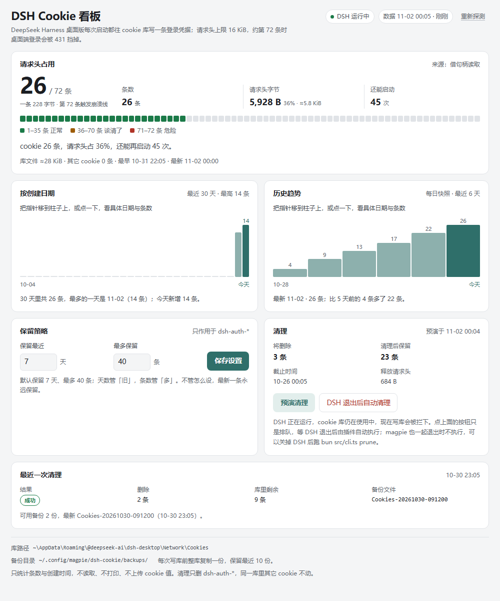
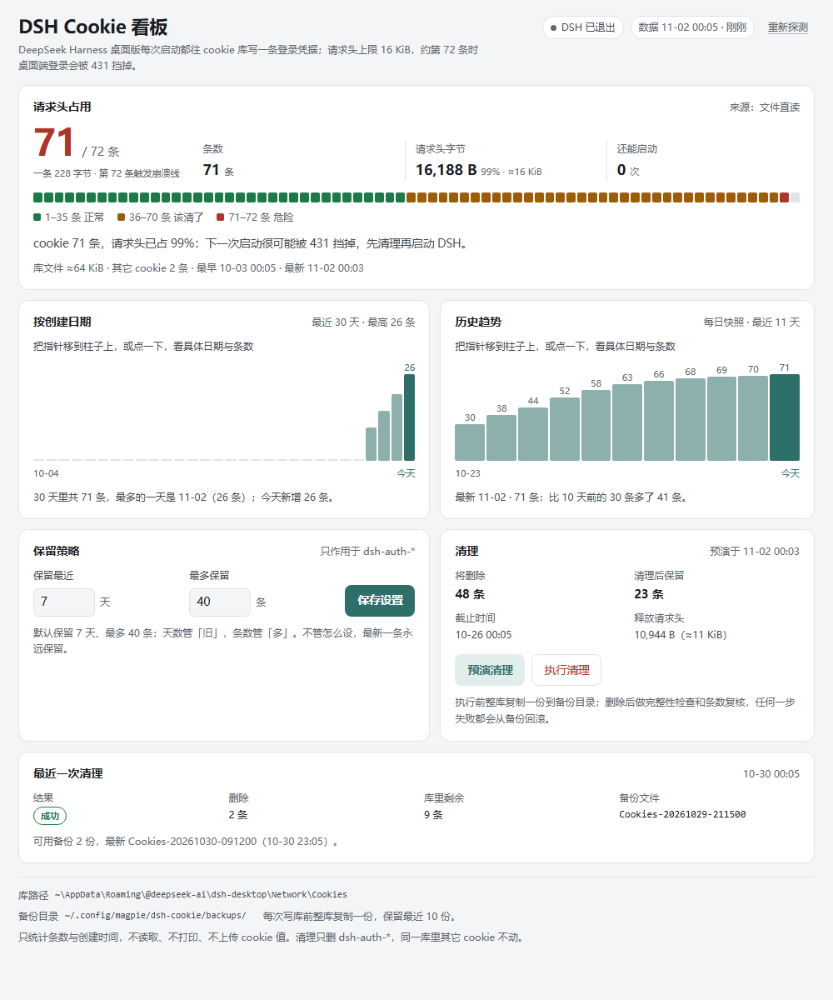
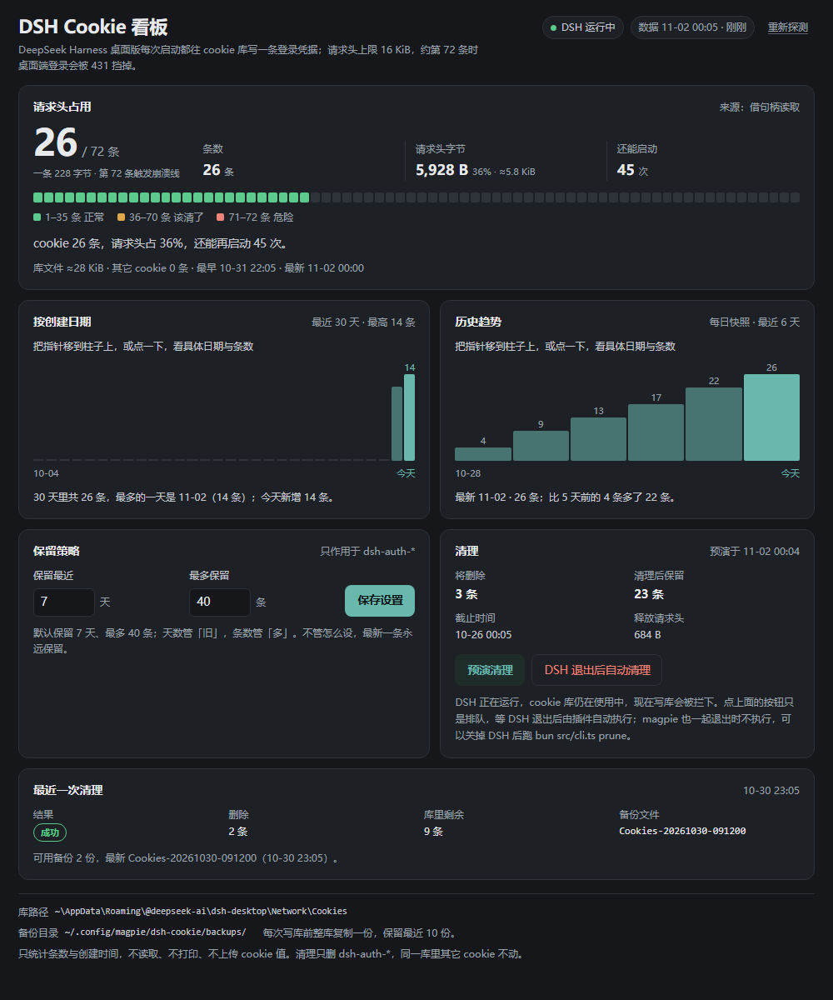

# DSH Cookie 看板（magpie 插件）

在 [magpie](https://usemagpie.ai) 里看住并清理 **DeepSeek Harness（DSH）桌面版**的登录 cookie。

DSH 每次启动都会往 Chromium 的 cookie 库里写一条 `dsh-auth-<43 位>`。每条在请求头里占 **228 字节**，而 Node 默认 `maxHeaderSize` 是 **16384 字节**——攒到 **第 72 条**，Host 的根请求就被 431 挡掉，桌面版表现为启动时报 `desktop welcome: Web authentication failed`。

这个插件做两件事：

- **看**：DSH 运行中也能读，显示条数、请求头占用、还能再启动几次、按创建日期分布、每日历史；
- **压**：按「保留最近 N 天 + 最多 M 条」清理过期登录 cookie，只动 `dsh-auth-*`，清理前备份、清理后校验、失败自动回滚。

## 功能

| 能力 | 说明 |
| --- | --- |
| 在线读 | Windows 借 Win32 句柄读被独占的库；macOS/Linux 直接读文件（POSIX 无强制锁） |
| 真实统计 | 字节落临时副本，用 `bun:sqlite` 查 `cookies` 表：条数、其它 cookie 数、创建时间分布、最老/最新 |
| 请求头换算 | 228 字节/条、16384 上限、36 提醒、71 危险、72 崩；百分比与剩余启动次数 |
| 保留策略 | `keepDays`（默认 7 天）+ `keepMax`（默认 40 条），两个条件取严；永远保留最新一条 |
| 预演 | 只算不删：cutoff、将删几条、留几条、释放多少请求头字节 |
| 安全清理 | 备份 → 事务删除 → `integrity_check` → 条数复核 → 任一步失败从备份回滚 |
| 排队执行 | DSH 运行中清理自动排队，退出后由 20 秒巡检执行，结果回写看板 |
| 多入口 | magpie 窗口看板、Agent 工具、离线 CLI |

## 安装

要求：magpie 已经在跑（插件宿主用 magpie 自带的 Bun，不需要系统 Bun）。

```bash
# 用本目录路径安装（路径换成你 clone 下来的目录）
magpie plugin add "/path/to/magpie-dsh-cookie"

# 或从 git 仓库
magpie plugin add "github:<owner>/magpie-dsh-cookie"
```

安装后：

1. 重载/重启 magpie（或在插件页面把插件关一下再开）；
2. 窗口侧边栏「插件」分组里会出现 **DSH Cookie 看板**；
3. `magpie plugin list` 里能看到它的工具与页面，没有 error 即正常。

## 界面



清理卡先给预演结果（将删几条、留几条、cutoff、释放多少请求头字节），确认后才写库；DSH 运行中按钮会变成「DSH 退出后自动清理」并排队。




## 看板怎么用

| 区域 | 内容 |
| --- | --- |
| 状态 | DSH 运行中 / 已退出；数据是否过期；读取来源（直接读文件 / 借句柄） |
| 仪表 | `dsh-auth-*` 条数、请求头字节与百分比、还能再启动几次；36 条提醒、71 条危险 |
| 分布 | 按创建日期统计的条数（最近 30 天） |
| 历史 | 每天一条条数快照（保留 90 天），页面画最近 14 天 |
| 保留策略 | 保留最近 N 天（默认 7，可 0–90）、最多保留 M 条（默认 40，可 1–72） |
| 清理 | 「预演清理」只算不删；「执行清理」在 DSH 退出后写库；运行中改为排队 |
| 结果 | 最近一次清理删了几条、备份文件名、失败原因 |

**保留规则**（两个条件取严）：

1. 早于 `现在 - N 天` 的 `dsh-auth-*` 删掉；
2. 剩下的如果还超过 M 条，从最旧的继续删到 M 条；
3. **永远保留创建时间最新的那一条**；
4. 其它 cookie（其它 host、非 `dsh-auth-*`）一条都不碰；
5. 创建时间未知的行（库损坏回退）一律不删。

### DSH 开着的时候怎么清

DSH 运行期间 cookie 库由 Chromium 掌管：Windows 上是**独占打开**（写库必失败），macOS/Linux 没有强制锁但并发写同样会撞 SQLite 锁。所以写库一律等 DSH 退出：

- 点「执行清理」→ 插件发现 DSH 还在跑 → **排队**（写进状态文件，页面显示「已安排」）；
- 插件每 20 秒巡检一次；DSH 完全退出后自动执行（备份 → 删 → 校验），结果回写看板；
- 不想排队就点「取消安排」。

DSH 完全退出后（Windows 从托盘退出，确认任务管理器里没有 `DeepSeek Harness.exe`；macOS/Linux 退出应用并确认无残留进程），也可以直接跑离线 CLI。

## Agent 工具

| 工具 | 说明 |
| --- | --- |
| `dsh_cookie_status` | 读数（只读，不返回 cookie 值） |
| `dsh_cookie_prune` | **默认 dryRun=true** 只预演；`dryRun:false` 才真删；DSH 运行中会排队 |
| `dsh_cookie_config` | 查看 / 保存保留策略 |

工具名在 magpie 里带插件前缀（例如 `magpie-dsh-cookie_dsh_cookie_status`），以 `magpie plugin list` 为准。

## 离线 CLI

需要 Bun 1.2+。可以用 magpie 自带的那份，不用另装：

**Windows（PowerShell）**

```powershell
$bun = (Get-ChildItem "$env:USERPROFILE\.cache\magpie\bun" -Directory |
  Sort-Object Name -Descending | Select-Object -First 1).FullName + "\magpie-bun.exe"

cd <插件目录>
& $bun src/cli.ts status
& $bun src/cli.ts plan   --keep-days 7 --keep-max 40
& $bun src/cli.ts prune  --keep-days 7 --keep-max 40   # DSH 必须先完全退出，否则会拒绝
& $bun src/cli.ts config --keep-days 5 --keep-max 30
& $bun src/cli.ts backups
```

**macOS / Linux**

```bash
bun_bin=$(ls -d "$HOME/.cache/magpie/bun"/*/magpie-bun 2>/dev/null | sort -V | tail -1)
cd <插件目录>
"$bun_bin" src/cli.ts status
"$bun_bin" src/cli.ts prune --keep-days 7 --keep-max 40
```

所有命令都支持 `--json` 输出，便于脚本处理。退出码：`0` 成功，`1` 失败/被拒绝，`2` 未知命令。

## 平台支持

| 平台 | 在线读（DSH 运行中） | 写库清理 |
| --- | --- | --- |
| Windows x64 | 借 Win32 句柄（`bun:ffi`），首次约 3–5 秒 | DSH 完全退出后；看文件是否被独占 |
| macOS | 直接读文件（POSIX 无强制锁） | DSH 完全退出后；看进程表 |
| Linux | 直接读文件 | DSH 完全退出后；看进程表 |

## 数据与隐私

| 项 | 位置 |
| --- | --- |
| 状态（配置 / 历史 / 队列 / 最近结果） | `<magpie 配置目录>/dsh-cookie/state.json`（Windows 默认 `%USERPROFILE%\.config\magpie\...`；macOS/Linux 默认 `~/.config/magpie/...`） |
| 备份 | 同目录 `backups/`（最多 10 份） |
| 页面快照 | 插件目录 `page/data.js`（宿主写、页面只读，已加入 `.gitignore`） |

DSH 的 cookie 库（桌面版 Electron userData 目录，已对照 deepseek-harness 仓库 discussion #11160 / #10802 核实）：

| 平台 | 路径 |
| --- | --- |
| Windows | `%APPDATA%\@deepseek-ai\dsh-desktop\Network\Cookies` |
| macOS | `~/Library/Application Support/@deepseek-ai/dsh-desktop/Network/Cookies` |
| Linux | `~/.config/@deepseek-ai/dsh-desktop/Network/Cookies` |

同目录的 `Cookies-journal` 是 SQLite 回滚日志：上次异常退出留下「热日志」时，插件会先让 SQLite 自愈再读/再写。

- **不暴露本机用户名**：页面、Agent 工具、CLI 与错误消息里的路径统一把用户目录换成 `~`（如 `~\AppData\Roaming\@deepseek-ai\...`）；真实绝对路径只在进程内部使用；
- 状态与备份**不含 cookie 值**：只统计条数、名字（页面只显示前 8 位）、创建时间；
- 不解析、不上传、不打印 cookie 值；
- 不杀进程、不改 DSH 配置、不碰 `Partitions\` 下的平台登录库。

> DSH 自身有 `cookieMaxAgeDays`（默认 30 天）控制单条 cookie 的绝对寿命，但它限制的是「一条活多久」，不是「攒了多少条」：每次启动都会新签一条、端口不同 → 新名字，重启频繁时 30 天内照样能到 72 条。所以这里按「天数 + 条数」双闸提前压。

## 故障排查

| 现象 | 原因 / 处理 |
| --- | --- |
| 看板一直「正在读取」 | 首次借句柄要 3–5 秒；页面每 5 秒刷新，稍等或点「重新探测」 |
| 「找不到 cookie 库」 | DSH 桌面版没装、路径不对，或用 `MAGPIE_DSH_COOKIE_DB` 指到实际库 |
| 「读不到 cookie 库（路径不对或权限不足）」 | macOS/Linux 权限问题；确认当前用户能读那个文件 |
| 「DSH 正在运行」无法清理 | 正常护栏：完全退出 DSH（Windows 托盘退出；macOS/Linux 退出应用），或等排队自动执行 |
| 「DB 有未完成的日志，恢复失败」 | 上次异常退出的热日志；先启动一次 DSH 让它自愈，再回来清理 |
| 清理失败并提示已回滚 | 复核没过，库已从备份恢复；看结果里的失败原因，必要时先备份再手工处理 |
| 插件页没出现 | `magpie plugin list` 看有没有加载错误；把插件关一下再开或重启 magpie |
| 页面显示「数据可能过期」 | magpie 长时间没探测；点「重新探测」，或确认 magpie 还在运行 |

## 环境变量

| 变量 | 作用 |
| --- | --- |
| `MAGPIE_DSH_COOKIE_DB` | 覆盖 cookie 库路径（默认按平台） |
| `MAGPIE_DSH_COOKIE_DATA` | 覆盖状态/备份目录（默认 `<magpie 配置目录>/dsh-cookie`） |

## 开发

```bash
# 任意 Bun 1.2+（也可用 magpie 自带的）
bun test
```

项目结构：

```
index.ts              插件入口（工具注册 / 启动服务 / 处理页面请求）
src/probe.ts          探测调度（Worker 线程 + 当前线程回退）
src/probe-worker.ts   Worker 里的探测体
src/win32.ts          借 Windows 句柄读被独占的 cookie 库
src/jar.ts            字节 → 临时副本 → bun:sqlite 查询；损坏回退正则
src/gauge.ts          228 / 16384 / 71 / 36 换算（唯一口径）
src/retention.ts      保留策略选行（纯函数）
src/prune.ts          备份 / 删除 / 校验 / 回滚
src/platform.ts       跨平台判断 DSH 是否在运行（Windows 独占锁 / POSIX 进程表）
src/state.ts          状态文件读写
src/dashboard.ts      组装并原子写 page/data.js
src/service.ts        编排：缓存、页面动作、排队、20 秒巡检
src/cli.ts            离线命令行
page/                 沙箱页面（无网络，靠 data.js + options 请求）
test/                 bun test（61 条）
```

设计细节与取舍见 [DESIGN.md](DESIGN.md)，版本变化见 [CHANGELOG.md](CHANGELOG.md)。

## 许可

MIT。借句柄读 cookie 库的思路来自 [dsh-cookie-guard](https://github.com/3150481853/dsh-cookie-guard)（MIT），本项目的 Bun FFI 实现是重写的。
